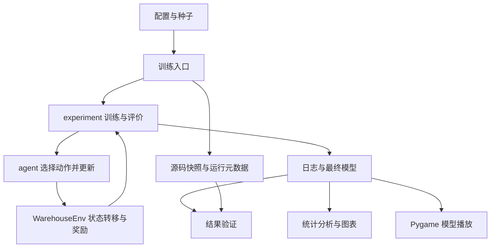

# 仓库导航与模块职责

本项目将强化学习实现、命令行入口、保存的实验依据和展示材料分开。整理范围是目录与说明，算法、训练协议和历史实验内容保持不变。

## 当前目录

```text
Team100_Warehouse_RL/
├── README.md                    使用入口与文件重要程度
├── config.json                  主实验配置
├── requirements*.txt            项目依赖、锁定版本及可选 notebook 依赖
├── demo.py                      手动操作与保存模型播放
├── run_experiments.py            主实验入口
├── run_sweep.py                  Q-Learning 参数扫描
├── run_adaptation.py             改图冻结评价与适应训练
├── reproduce.py                  调度测试、实验与验证命令
├── verify_results.py             核对记录与模型行为
├── warehouse/                   当前实现
├── tests/                       当前自动化测试
├── pytest.ini                   限定测试范围，避免收集历史快照测试
├── results/
│   ├── main/                    主实验原始记录与最终模型
│   ├── sweep/                   参数扫描记录与最终模型
│   └── adaptation/              改图实验记录与最终模型
├── output/
│   ├── jupyter-notebook/        已执行的分析笔记本
│   └── figures/                 报告用图
├── tools/                       从记录导出报告图表
├── scripts/macos/               可选安装与播放启动器
└── docs/
    ├── architecture.md          本说明
    ├── EXPERIMENT_RECORDS.md    实验文件保留规则
    ├── GITHUB_UPLOAD.md         上传步骤
    └── validation/              历史验证文本，日期及原环境见文件内容
```

## 哪些必须保留

完整课程仓库应保留当前目录中的源码、测试、配置、依赖、实验记录和分析材料。仅演示时，主要读取 `demo.py`、`warehouse/` 以及选定结果目录的配置和模型；但 `warehouse/` 的导入还会使用配置检查和环境注册，因此不要随意拆删其中模块。

`results/` 中的 CSV 是原始日志，JSON 是配置、指标和来源信息，`.pt` / `.npy` 是最终模型，`source_snapshot/` 是记录当时的源码。快照与当前 `warehouse/` 作用不同，删除或修改快照会影响来源验证。结果目录内的图与截图是保存的展示材料；运行验证通常不依赖这些图片，但报告引用时需要保留。

## 哪些可以省略或重新生成

- `scripts/macos/`：macOS 便利工具，其他系统不需要；可直接使用 README 的命令。
- `docs/validation/`：历史检查输出，用于参考；不参与程序运行，也不是实时测试状态。
- `output/figures/`：展示图可以由 `tools/export_report_figures.py` 重新生成。
- notebook 的保存输出：便于不执行代码也能阅读；重跑需要额外依赖。
- `.venv/`、缓存、系统文件和新运行的恢复 checkpoint：不随仓库提交，已由忽略规则管理。恢复 checkpoint 只在继续对应训练时需要。

可再生材料并非没有价值；本次将其归类保留，未删除实验依据。

## 当前模块与数据流

| 模块 | 职责 | 主要项目内依赖 |
|---|---|---|
| `configuration.py` | 检查地图、奖励、种子和训练参数；计算探索衰减到下限的步数 | 无 |
| `env.py` | 状态转移、奖励、结束条件、BFS 参考路径及渲染 | configuration |
| `agents.py` | Q-Learning / DQN 的选动作、更新与模型读写 | 无其他 warehouse 模块 |
| `checkpoint.py` | 保存与恢复模型、优化器、回放及随机状态 | 接收 agent 对象 |
| `provenance.py` | 来源哈希、源码快照、输出目录保护和完整种子目录检查 | 无 |
| `experiment.py` | 训练、贪婪评价、随机基线和日志 | env、agents、configuration、checkpoint、provenance |
| `analysis.py` | 读取结果、计算统计并作图 | env、experiment.write_csv、provenance |
| `__init__.py` | 向 Gymnasium 注册 WarehouseNav-v0 | Gymnasium 注册接口 |

训练入口读取配置，调用训练模块；训练模块让 agent 选择动作、让环境执行动作，再把转移交给 agent 更新，最后写入日志和模型。分析模块读取保存记录生成统计与图；验证入口读取模型和记录重新评价。演示入口读取模型并显示环境，不训练模型。

依赖方向按当前结构维护：入口调用 `warehouse/`；底层环境和算法不导入 GUI、报告工具或实验入口。分析读取实验产物，训练模块不反向依赖分析模块，避免循环导入。历史 `source_snapshot/` 不参与当前实现的正常导入。

## 第三方依赖与运行前提

NumPy 负责数组及随机采样，Gymnasium 负责环境接口，PyTorch 负责 DQN，Matplotlib 负责图表，Pygame 负责桌面播放，pytest 负责测试。`requirements-lock.txt` 记录固定版本，`requirements.txt` 提供版本范围；`requirements-notebook.txt` 引入锁文件并增加 notebook 执行所需包。

运行任务前应创建本机 Python 环境并安装依赖；播放和验证还要求对应结果目录存在完整的配置与最终模型；生成图表需要保存日志；完整复现需要执行训练。macOS 启动器仍假定仓库根目录的 `.venv/`，它们会先切换到该根目录。

## 修改需求对应位置

| 需求 | 当前修改位置 | 相关检查 |
|---|---|---|
| 地图、奖励或预算 | 新配置；规则变化时改 env.py | 环境测试，另开结果目录 |
| Q-Learning / DQN | agents.py | 更新目标、模型读写和复现测试 |
| 训练与记录 | experiment.py、对应 run_*.py | 恢复、目录保护、日志一致性 |
| 目录保护与来源留档 | provenance.py、调用它的入口 | record_safety / verification 测试 |
| 指标与图表 | analysis.py、tools/export_report_figures.py | 对照原始日志核对统计 |
| 验证完整性 | verify_results.py | 缺文件、缺种子等反向测试 |
| 桌面显示和操作 | demo.py | 模型播放、截图及键盘操作 |

后续工程修复已完成扫描和适应入口的覆盖保护、随机基线完整性检查、正式分析的种子完整性检查及新扫描的来源留档。最终修复还检查评价回合序列与训练累计步数，并处理探索率为零的边界配置。详情与验收命令见 [开发说明](development.md)。历史扫描没有运行级元数据，验证会明确标注来源哈希不可核验，不补造历史来源。

## 本次整理决定

将实验保留指南归入 docs；将历史验证文本从 results 根目录移至 docs/validation；将 macOS 启动器归入 scripts/macos 并调整工作目录。保留根目录运行入口、依赖清单、results 和 output 的路径，避免牵动命令、笔记本和历史来源校验。没有为这次轻量整理引入新框架、额外规格系统或重复的任务文档。

## 系统流程



训练时的动作由 agent 决定，环境负责规则；分析与 GUI 读取已保存记录。BFS 仅提供评价参考，不向学习器提供路径。
